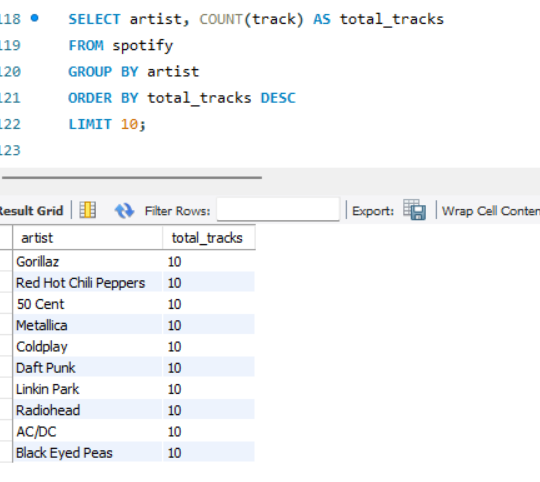

# Spotify & YouTube Music Analytics using MySQL

## Overview
This project focuses on analyzing Spotify and YouTube music data using MySQL. The objective is to explore music trends, track performance, artist popularity, audience engagement, and streaming patterns through SQL queries.

The project uses real-world music data containing Spotify audio features and YouTube engagement metrics.

## Tools Used
- MySQL
- MySQL Workbench
- SQL
- GitHub

## Dataset
The dataset contains 20,594 records and 24 columns, including:

- Artist and Track
- Album and Album Type
- Danceability, Energy and Valence
- Tempo and Duration
- YouTube Views, Likes and Comments
- Spotify Streams
- Official Video and Licensing Information

## Business Questions & Analysis
1. Identify tracks based on their streaming counts.
2. List unique albums and their respective artists.
3. Calculate total comments on licensed tracks.
4. Retrieve all single tracks.
5. Count the total tracks released by each artist.
6. Calculate average danceability for each album.
7. Identify the top 5 tracks with the highest energy.
8. Find tracks where views exceed likes and the official video is TRUE.
9. Identify tracks with above-average liveness.
10. Calculate the difference between maximum and minimum energy for each artist.
11. Find tracks with an energy-liveness ratio above 1.2.
12. Find the top 3 most-viewed tracks for each artist.
13. Compare YouTube and Spotify popularity by artist.
14. Calculate rolling average streams for each artist.
15. Categorize tracks into High, Medium and Low danceability.

## SQL Concepts Used
- SELECT, WHERE and DISTINCT
- GROUP BY and HAVING
- Aggregate Functions (SUM, AVG, COUNT, MAX, MIN)
- Common Table Expressions (CTEs)
- CASE Statements
- Subqueries
- Window Functions
- DENSE_RANK()
- PARTITION BY
- ORDER BY
- Rolling Averages

## Project Objectives
- Analyze music streaming performance.
- Understand artist and track popularity.
- Explore audio characteristics of music.
- Compare Spotify and YouTube engagement.
- Practice advanced SQL queries and analytical techniques.

## SQL Analysis & Results

### Top 10 Artists by Number of Tracks

This query identifies the top 10 artists based on their total number of tracks in the dataset.

## How to Use
1. Download the repository.
2. Create the database using the provided SQL script.
3. Import the CSV dataset into MySQL Workbench.
4. Execute the SQL queries.
5. Explore the results and music trends.

## Author
**Adarsh Patel**

Aspiring Data Analyst | SQL | Excel | Power BI | Tableau

GitHub: [adarshpatel4873-ctrl](https://github.com/adarshpatel4873-ctrl)
